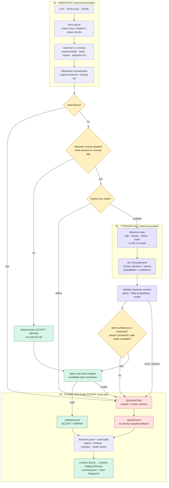

# Jev Data Quality Triage Pipeline

**Deterministic checks first. Typed AI judgments where ambiguity remains. Auditable routing throughout.**

[](https://github.com/Zuhaib2004/jev-data-quality-triage/actions/workflows/ci.yml)

A Python pipeline that reads customer records from CSV, JSON, or JSONL and returns **ACCEPT**, **REPAIR**, or **QUARANTINE**. Clear validation failures never reach AI. Ambiguous records can be evaluated by [Jev, TypeSafe’s decision model](https://docs.typesafe.ai/introduction). Outputs include confidence, reason codes, original values, proposed changes, and model provenance.

This is a working reference implementation with a deliberately explicit customer-data contract, not a universal anomaly detector. It runs offline by default. The Jev integration uses the official REST contract; unit tests substitute an HTTP transport and do not claim live-model accuracy.

## What it does

- Reads CSV, JSON arrays, and JSONL; rejects malformed structure rather than silently dropping data.
- Detects missing values, invalid types/ranges, unsupported values, duplicate IDs, and records requiring semantic review.
- Applies only allowlisted canonicalizations: whitespace trim, email-domain casing, integer age conversion, country aliases, status casing.
- Uses two Jev `Choice` questions: a typed decision and a predefined reason code.
- Quarantines low-confidence, contradictory, failed-provider, or unrepairable decisions.
- Writes validated records separately from quarantined records, plus JSONL and SQL audit trails.
- Publishes each run as a new directory only after processing and database commit succeed.

## Architecture



See [design decisions and limitations](docs/design.md) for confidence semantics, privacy boundaries, failure behavior, and operational tradeoffs.

## Run in 60 seconds

Python 3.11 or newer:

```bash
python -m venv .venv
source .venv/bin/activate
pip install -e '.[dev]'
jev-triage examples/customers.csv --output runs
jev-triage examples/customers.json --output runs
```

No API key, network call, or paid service is required for offline mode. Ambiguous rows go to quarantine; they are not assigned simulated AI answers.

CSV demo outcome: **0 ACCEPT · 3 REPAIR · 5 QUARANTINE**. CSV ages arrive as strings, so otherwise clean rows are correctly recorded as type repairs. The JSON example includes a native integer and demonstrates ACCEPT.

### Use real Jev

```bash
export TYPESAFE_API_KEY='your-key'
jev-triage examples/customers.json --provider jev --allow-ai-data \
  --threshold 0.85 --output runs
```

Get a key from [TypeSafe](https://console.typesafe.ai). `--allow-ai-data` explicitly enables transmission of the documented fields. Do not put credentials in source control. The CLI does not automatically load `.env`.

The endpoint is fixed to `https://api.typesafe.ai/v1/systemone`; redirects are disabled. `--model jev-latest` is the default. For reproducible evaluations, select an available concrete model version using `--model` and retain the returned model name in the audit. Changing model versions can change decisions.

## Input contract: customer-v1

| Field | Contract | Policy |
|---|---|---|
| `record_id` | Required, non-empty string, ≤320 characters | Trim; duplicate IDs within a run are quarantined |
| `email` | Required string with basic `local@domain.tld` shape | Trim; lowercase domain only; not deliverability verification |
| `age` | Integer 0–120 | Convert 1–3 ASCII digits; >100 requires review; booleans/floats rejected |
| `country` | US, CA, GB, DE, FR, IN, AU | Uppercase; USA/United States → US; UK/United Kingdom → GB |
| `status` | active, inactive, pending | Trim + lowercase |
| `notes` | Optional string/null, ≤2,000 characters | Every non-empty value triggers semantic review |

Extra fields are quarantined. Missing business facts are never invented. Country support is a declared business-market list, not an assertion that other countries are invalid. Null optional notes and absent notes are both allowed.

```json
{"record_id":"c1","email":"Ada@example.com","age":34,"country":"US","status":"active"}
```

## When deterministic validation replaces AI

| Situation | Handling | Why |
|---|---|---|
| Missing email, invalid age/status/country, wrong types | QUARANTINE locally | Exact rules are cheaper, repeatable, and authoritative |
| Whitespace, numeric strings, known country aliases | REPAIR locally | Transformation is predefined and reversible via audit |
| Clean fields, no notes, ordinary age | ACCEPT locally | No semantic question remains |
| Notes might conflict with status; unusually high but valid age | Jev if explicitly enabled | Contextual judgment can help; it cannot override hard rules |
| AI failure, uncertain decision/reason, adverse reason | QUARANTINE | Review is preferable to unsupported acceptance |
| Jev requests REPAIR but no local repair exists | QUARANTINE | This system does not ask AI to invent replacement values |

Jev does not generate free-form explanations. This pipeline asks for a closed-set reason (`CONSISTENT`, `SAFE_NORMALIZATION`, `CONTRADICTION`, `INSUFFICIENT_EVIDENCE`) and maps it to a human-readable description in code. These are routing reasons, not model chain-of-thought or proof of correctness.

## Outputs and SQL

Each invocation returns a new run directory:

```text
runs/<run-id>/
├── validated.jsonl   # Canonical records from ACCEPT and REPAIR
├── rejected.jsonl    # Quarantine envelopes with originals and reasons
├── decisions.jsonl   # Every outcome, including provider probabilities
├── audit.sqlite      # Run metadata, decisions, constrained views
└── summary.json      # Counts, policy version, threshold, parsed-input hash
```

Every decision records original data, findings, changes, source, confidence, final route, and (when available) the model verdict. Proposed changes on quarantined records are audit-only; the validated record is null. Model choice and final route are separate because policy gates may override the model.

```bash
sqlite3 runs/<run-id>/audit.sqlite < sql/quality_report.sql
```

The report groups routes and sources, counts quality findings, and lists rejected records for review. `validated_records` and `rejected_records` views enforce clear consumer separation. The executable [SQL schema](src/jev_triage/schema.sql) includes route and JSON constraints.

**Confidence:** deterministic `1.0` means certainty that the configured rule was applied, not that the underlying data is true. Jev confidence is provider-reported distribution confidence, not a guarantee of correctness. Fallback confidence is null. Tune thresholds against labeled, representative data before relying on automated acceptance.

## Tests and CI

```bash
ruff check .
python -m unittest discover -s tests -v
```

Tests cover hard-rule precedence, safe repairs, immutable originals, duplicate IDs, low confidence, adverse reasons, malformed model output, bounded retries, redaction, CSV/JSON parsing, SQL views, and removal of incomplete runs. HTTP tests use `httpx.MockTransport`; no secret is needed in CI.

GitHub Actions runs lint/tests on Python 3.11, 3.12, and 3.13, plus a Docker build and offline smoke run. CI uses read-only repository permissions.

## Docker

```bash
docker build -t jev-triage .
docker run --rm jev-triage

# Persist output using a named volume owned by the non-root container user:
docker volume create jev-triage-data
docker run --rm -v jev-triage-data:/data jev-triage

# Supply your own input file:
docker run --rm -v "$PWD/examples:/input:ro" -v jev-triage-data:/data \
  jev-triage /input/customers.json --output /data/runs
```

For real Jev calls pass `-e TYPESAFE_API_KEY` (export it first), then add `--provider jev --allow-ai-data`. The key is read at runtime and is never baked into the image. Bind-mounted output folders must be writable by UID 10001.

## Scope and roadmap

The current policy targets small-to-medium customer datasets. CSV/JSONL are streamed; JSON arrays are loaded in memory; duplicate IDs use an in-memory set. API calls are sequential with a 20-second timeout and at most three attempts. Partial external calls may have occurred even if a late input error prevents local publication. There is no cross-run deduplication, human review UI, scheduling, automatic quarantine release, or claimed accuracy benchmark.

Next steps: labeled evaluation dataset, configurable policy profiles, durable job scheduling, and reviewed quarantine replay. No real customer data is included; all examples are synthetic.

## API references

- [Official TypeSafe REST API](https://docs.typesafe.ai/api)
- [Choice primitive](https://docs.typesafe.ai/primitives/choice)
- [Confidence semantics](https://docs.typesafe.ai/confidence)

REST integration verified against the official documentation on September 29, 2026. Live inference requires your own API key and is not exercised by the offline tests.
